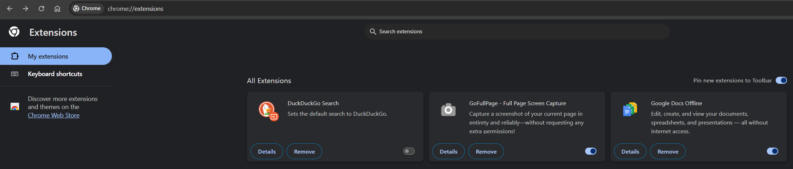
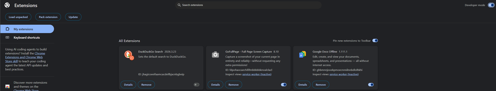
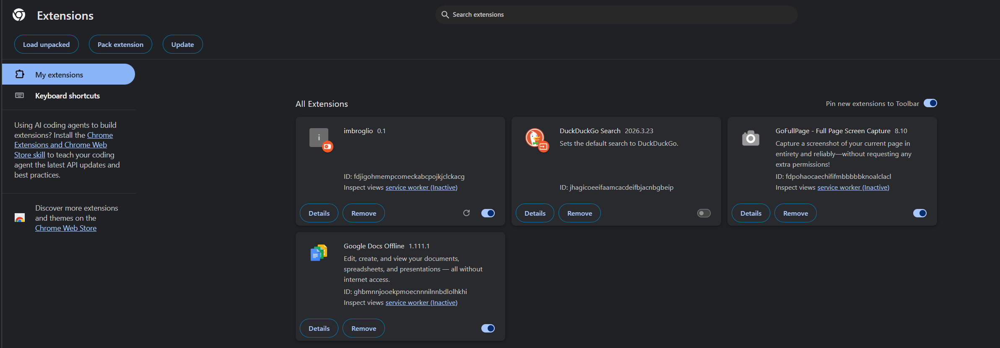
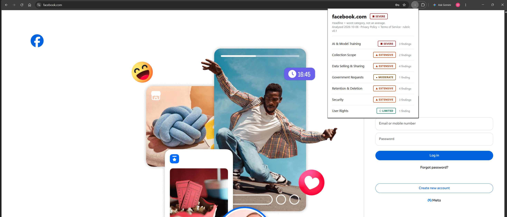

#### Extension

#### unpacked loading Instructions
##### *Note: I'm only sure of these instructions on Google Chrome*
1. Visit `chrome://extensions/`

2. Toggle on **Developer Mode**. This setting can be found on the top right. 

3. Developer mode will enable several new options. Click on **Load Unpacked** and select the **extension** folder in your file explorer program. For me this was `C:\learning\university\fal-26\Senior Experience\extension`. This will load imbrolio 0.1. 

4. visit `facebook.com`. There should be an `i` next to the extensions icon. Upon clicking on the `i` a temporary card should be loaded. 

##### Additional Notes

Manifest V3 browser extension. Thin client over the public read API — no
client-side analysis, no account. Built in weeks 11–13.

- more to come