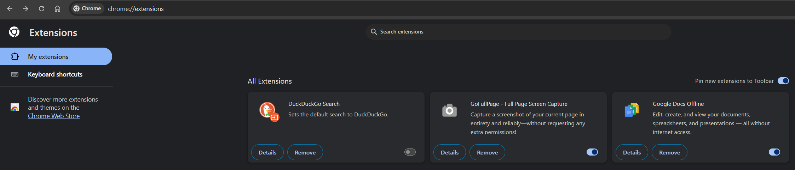
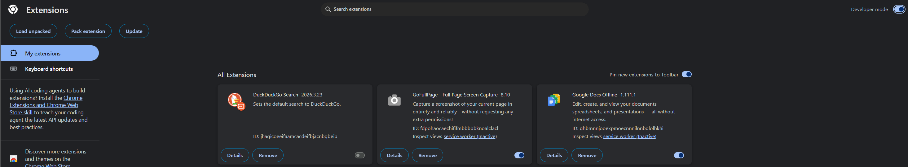
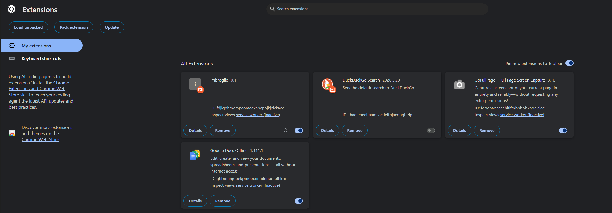

# Browser extension

Shows the Imbroglio rating for the site in the current tab, following the UX
team's Figma (imbroglio browser extension): the toolbar icon carries the
site's worst level as a badge; the popup opens on an overview (the overall
rating and its score out of 100, in plain words, counts per level, the three
biggest flags, and a Share button that copies the report's link), with a
category breakdown behind it and a "what you can do" screen with one action
per flagged category. An action gets a button only when the lookup carries
the site's own page for it (the API's link harvest); otherwise it is text
and a "mark done". Manifest V3; works in Chrome, Edge, Opera and other
Chromium browsers.

It is a thin client over the public read API. Nothing is analyzed in the
browser, there is no account, and the site's name never leaves the browser:
`background.js` hashes the domain with sha256 and sends only the first five
characters of the hash to `imbroglio.io/api/v1/lookup/<prefix>`, then picks
the site out of the matches by its full hash. Lookups only read cached
results. A site we haven't analyzed gets a link to request it on the website,
where the request limits apply.

## Files

- `manifest.json`: permissions (`tabs` to know which site each tab is on, so
  the badge can be drawn as you browse; `notifications` for the two one-time
  alerts, "warn me on Extensive sites" and "tell me when a site's policy
  changes"; `activeTab` for the popup; `storage` for the two switches, the
  per-site records behind the alerts, and the local API override). The
  per-site records are kept under the site's sha256 hash with a date beside
  it, never the site's name. The badge lookups are the same hash-prefix lookups as the popup's,
  cached ten minutes per site, so browsing still never sends a site's name.
- `background.js`: the lookup and the badge. The icon is drawn in a canvas
  (the logo, plus the worst level's shape in the corner; dimmed with no
  badge for a site we haven't rated), so no badge icons are shipped as files.
- `popup.html`, `popup.css`, `popup.js`: the three screens. Tier colors and
  rating marks are the website's (`web/src/components/design.tsx`). Open
  `popup.html?mock=ready` (or `unknown`, `not_analyzed`, `error`) in a plain
  browser tab to see each state with sample data, no extension needed.
- `icons/`: the logo at the sizes Chrome asks for (the store listing and the
  extensions page; the toolbar icon is drawn).

## Loading it unpacked

1. Open `chrome://extensions/` (Opera: `opera://extensions`).
   
2. Turn on **Developer mode** (top right).
   
3. Click **Load unpacked** and pick this `extension` folder.
   
4. Visit a rated site (tiktok.com, nytimes.com) and click the Imbroglio icon.

After pulling changes, click the reload arrow on the extension's card.

## Local development

By default the extension talks to imbroglio.io. To point it at a local API,
open the service worker console from the extension's card and run:

```js
chrome.storage.local.set({ apiBase: "http://localhost:8765" })
```

and `chrome.storage.local.remove("apiBase")` to go back. Opera blocks
extension requests to localhost, so test locally in Chrome or Edge.
